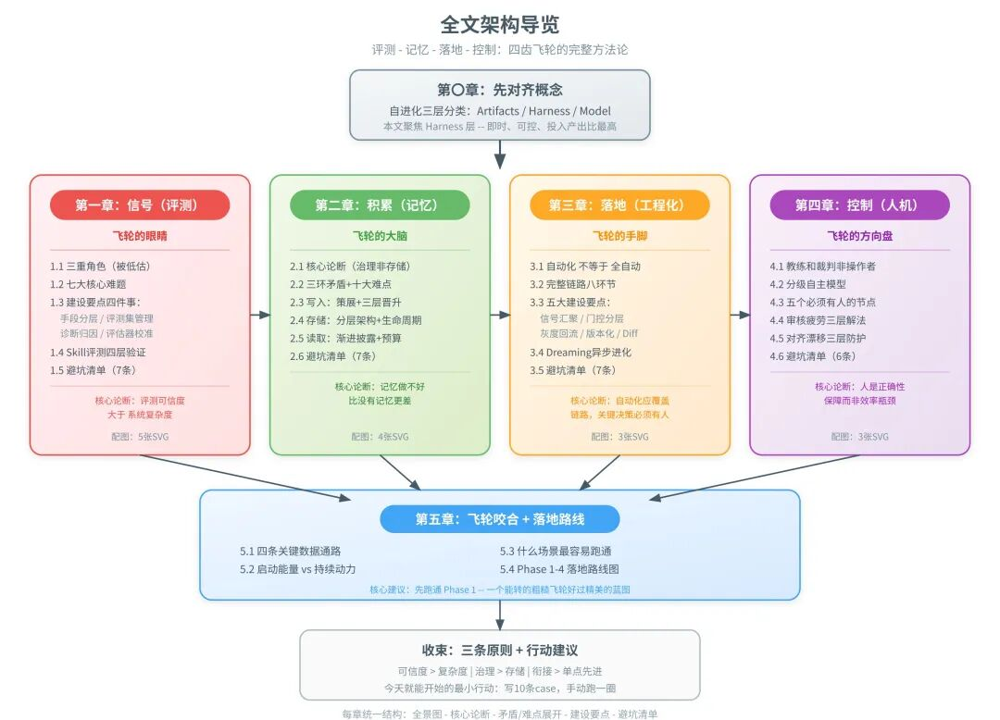
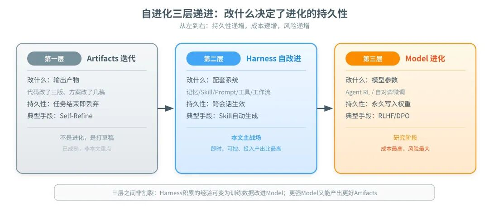
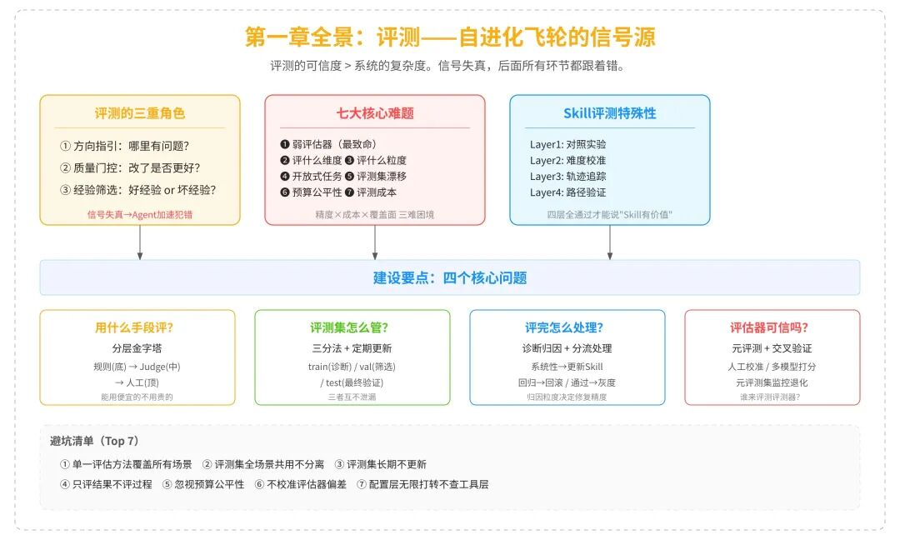
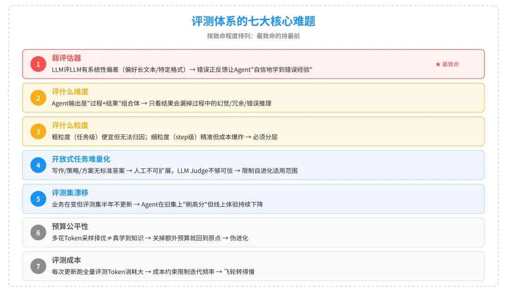
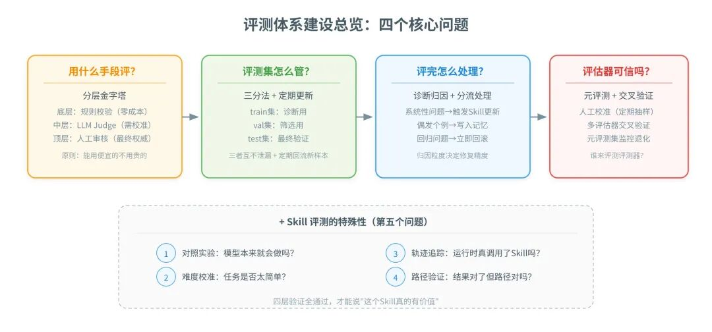

# Agent 自进化飞轮：评测 → 记忆 → 落地 → 控制

> **来源**：微信公众号文章 ｜ **作者**：yannisyang、ethanytzhou
> **原文**：https://mp.weixin.qq.com/s/5VDN-T9K8Wr-DaQ15-I6CA
> **正文字数**：约 30,150 字 ｜ 41 张图
> **蒸馏日期**：2026-09-23

---

# 一、一句话说清

> **这篇文章讲的是：怎么让 Agent 越用越聪明** ——
> **方法是搭一条「做过 → 记住 → 变好」的工程闭环，即四齿飞轮**：
> **评测（信号）→ 记忆（积累）→ 落地（工程化）→ 控制（人机协作）** ✅
>
> **开篇的问题意识（很扎心）**：
> **"你的 Agent 上线半年了 —— 它比第一天聪明了吗？
> 它可能还在犯三个月前犯过的错……半年的线上流量喂过去，它一点经验都没攒下来。"** ⚠️
> **"问题不在模型不够强，而在没有人给它搭一条从'做过'到'记住'到'变好'的路。"** ✅

**⭐ 作者引用的来源**（有出处，可核查）：
> **Anthropic 递归自改进报告 · 斯坦福 CS329A 课程 · EvoAgentX 等开源框架 · Anthropic Dreaming 机制（2026.5）· SkillOS 研究**

---

# 二、⭐ 先对齐概念：自进化改的到底是什么（**三层**）

| 层 | 改什么 | 持久性 | 现状 |
|---|-------|-------|------|
| **第一层 Artifacts** | **改输出产物**（多改几版）| ⚠️ **任务结束就没了** | 已成熟，**"这不是进化，这是打草稿"** |
| **第二层 Harness** ⭐ | **改配套系统**（**记忆 / Skill / Prompt / 工具配置 / 工作流**）| ✅ **跨会话生效** | ⭐ **当前主战场** |
| **第三层 Model** | 改模型权重（Agent RL / 微调）| 最强 | 仍在研究阶段 |

**⭐⭐ 为什么 Harness 层是主战场**（原文四字：**即时、可控**）：
> **改完立刻生效，不需重训；改错一键回滚，不会不可逆。** ✅
>
> **实测数据（原文）**：Harness 层进化 → **迭代次数减少 70%、Token 消耗降低 80%+**；
> Agent Memory 场景 **Token 节省超 60%** —— **"一个模型参数都没动"** ⚠️

**⭐ 例子（同一问题，三层解法）**：
> **问题**：Agent 处理"日期格式转换"常出错
> · **Artifacts**：让它在本次任务多试几次 → **下次还是不会**
> · **Harness**：**写一条 Skill**（"先识别源格式再转换"）→ **下次直接 follow** ✅
> · **Model**：微调模型 → 成本最高，但最根本
>
> **⭐ 结论**：**"对绝大多数团队，写一条 Skill 就够了 —— 不需要微调模型。"** ✅

---

# 三、⭐⭐ 三条核心论断（**全文最值钱的**）

## 论断 1｜**自进化的瓶颈不是技术点，是环节之间的衔接**

> **"评测信号必须能流进记忆和 Skill 更新；更新后必须能被评测验证；
> 验证结果必须能反哺下一轮。这条链路断了任何一环，飞轮都转不起来。"** ⚠️

**开篇点出的现实（三个团队，各做一块，飞轮不转）**：
| 团队 | 做了什么 | 结果 |
|------|---------|------|
| **评测团队** | 搭了评分系统 | ⚠️ **分数去了周报，没进改进链路** |
| **记忆团队** | 做了向量检索 | ⚠️ **召回噪声太高，最后被默默关掉** |
| **Self-Improve 团队** | 探索 Skill 自动生成 | ⚠️ **质量参差，没评测筛选、没版本管理** |

## 论断 2｜⭐ **评测的可信度 > 系统的复杂度**

> **"一个简单但评测可信的系统，远好于一个复杂但评测失真的系统。
> 错误的正反馈会让 Agent 加速开往悬崖。"** ⚠️

## 论断 3｜⭐ **记忆系统的核心不是存储能力，而是治理能力**

> **"存得多不如治得好 —— 版本控制、主动遗忘、冲突解决、来源溯源，
> 这些'不性感'的治理能力，才是决定记忆系统到底帮忙还是添乱的关键。"** ✅

---

# 四、四个齿的精要

## 齿 1｜评测（信号）

### ⭐ 评测的三重职责（**传统评测只有一个**）
| 职责 | 含义 |
|------|------|
| **方向指引** | 告诉系统"哪里有问题"，决定进化朝哪走 |
| **质量门控** | 更新前验证"改了是否更好" |
| ⭐ **经验筛选** | **判断一次执行是"好经验"该沉淀，还是"坏经验"该丢弃** |

> **⚠️ 为什么这三重很重要**：
> **传统评测打错分 = "上线了个不够好的版本"；
> 自进化评测打错分 = "Agent 学到了错误经验，并持续污染后续所有任务"** ⚠️

### 评测的七大难题（按"最致命→最常见"）
| # | 难题 | 要点 |
|---|------|------|
| **1** ⭐ | **弱评估器** | **用 LLM 给 LLM 打分**：偏好长文本 / 特定格式 / 表面正确性 → **系统性偏差，非随机噪声** ⚠️ |
| **2** | 评什么维度 | Agent 输出是"推理+工具调用+中间结果+答案"的**组合体**，只看最终答案会漏（**"虚假通过"下次翻车**）|
| **3** | 评什么粒度 | 粗粒度便宜但不知"错在哪"；细粒度精确但成本指数增长（一轮几百到上千次 LLM 调用）|
| **4** | 开放式任务难量化 | 写作/方案类没有确定对错 → **建议用"偏好排序"代替"绝对打分"** |
| **5** | **评测集漂移** | 半年不更新 → **"数字漂亮但用户骂街"** ⚠️ |
| **6** ⭐ | **预算公平性** | **"很多'自动进化'的提升，可能仅来自多花钱"**（Best-of-N）**→ 必须在预算对等条件下比** ⚠️ |
| **7** | 评测成本 | 每次改动跑全量吃不消 → **分层：改动跑轻量回归，定期跑全量** |

### ⭐ 建设要点
| # | 要点 | 关键 |
|---|------|------|
| **1** | **评测手段分层** | **底层**：规则/自动化校验（**零成本、100% 客观** ← 很多团队没用足）<br>**中层**：LLM-as-Judge（⭐ **生成模型与评估模型必须分离**、**temperature=0**、**输出结构化**、**分维度独立评**）<br>**顶层**：人工抽样 + **元评测集**（几十条"绝对正确/绝对错误"样本，定期校准评估器）|
| **2** ⭐ | **评测集三分法** | **train（50-60%，只用于诊断）· val（20-30%，只用于筛选，绝不暴露给生成方）· test（15-20%，只用于最终验证）**<br>⚠️ **三者互不泄漏**；val 每 2-4 周更新，test 每 1-2 月更新 |
| **3** ⭐ | **评测的终点是诊断归因** | 按失败类型分组 → 走不同链路：<br>· **系统性问题** → 触发 Skill/Prompt 更新<br>· **偶发个例** → 写入记忆作"教训/反例"<br>· **能力缺失** → 触发工具/知识补充<br>· **回归问题** → **立即回滚 + 人工介入** |
| **4** | **评估器也要被评测** | 元问题："谁来评测评测器？" → 四种互补机制 |

### ⭐⭐ Skill 评测的四层验证（**跟他最相关**）

| 层 | 验证什么 | 怎么验 |
|---|---------|-------|
| **第一层** | **模型本来就会做吗？** | **有 Skill / 无 Skill 两组对照实验** —— 无 Skill 也能做对 → **贡献是零** ⚠️ |
| **第二层** | **任务是否太简单？** | 要有**难度梯度**（无 Skill 时"能做对一部分也做错一部分"才看得出增量）|
| **第三层** | ⭐ **运行时真的调用了 Skill 吗？** | **轨迹追踪**：查执行轨迹里有没有 Skill 定义的关键步骤 |
| **第四层** | ⭐ **结果对了，路径对吗？** | **路径验证**：是否**绕过了 Skill 的关键校验步骤**碰巧对了 → **下次会翻车** ⚠️ |

**⭐ 工程化建议（原文）**：
> **每个 Skill 上线前必须跑对照实验；评测 case 要有难度梯度；
> 引入轨迹评测（trace-level）；定期复评（API 改了、需求变了会过时）** ✅

## 齿 2｜记忆（积累）

### ⭐ 核心论断："记忆做不好，比没有记忆更差"

> **现象**：多个团队加了长期记忆 → **召回不准、注入上下文后干扰 Agent** → **最后默默关掉** ⚠️
> **认知转变**：**把记忆当作"治理系统"而非"存储系统"** ✅
> **类比**：**Git 的价值不在"能存代码"，而在版本控制、分支管理、冲突解决、审核流程** ✅

### 三环十难点（写入 / 存储 / 读取）
| 环 | 难点（摘关键的） |
|---|----------------|
| **写入** | ① 价值判断难（**有价值的信息可能藏在不起眼的细节里**，如"这个 API 凌晨 3 点会限流"）② 正负反馈不对称 ③ 粒度选择 ④ ⭐ **隐性知识难捕获**（**最有价值的往往是"什么不能做"**）|
| **存储** | ⑤ ⭐ **记忆污染（上下文投毒）** —— 一条错误记忆被发现前可能已影响数百次任务 ⑥ 时效性衰减 ⑦ 记忆冲突 ⑧ 存储成本失控 |
| **读取** | ⑨ 检索噪声（**向量相似 ≠ 语义相关**）⑩ 上下文预算分配 |

### ⭐ 建设要点
| # | 要点 | 关键 |
|---|------|------|
| **1 写入** | **"策展而非全存"** | **Agent 不是录音机，是策展人**；<br>**正信号才写入**（用户确认/评测通过/任务成功）；<br>**失败也存，但标记为"反例/陷阱"**（"一个明确的反例比一个模糊的正例更有价值"）⭐ |
| | ⭐ **非对称淘汰** | **好经验强化 +0.05 远慢于坏经验淘汰 −0.12**（**淘汰是强化的 2.4 倍**）<br>逻辑：**一条错误记忆的伤害 > 一条正确记忆的收益** ✅ |
| **2 存储** | **分层架构 + 生命周期** | 四层：**L0 原始对话 → L1 原子事实 → L2 场景块 → L3 用户画像**<br>**默认用顶层（轻量高密度），需要时才钻取下层**<br>生命周期：**版本控制 / 演化 / 主动遗忘 / 冲突解决** |
| **3 读取** | **渐进披露 + 严格预算** | **Step1 默认只注入顶层**（Persona + Skill 前言，约 500-800 token）<br>**Step2 按需检索中层**（三路并行：语义向量 + 全文关键词 + 精确匹配）<br>**Step3 需要时才钻取底层**<br>⭐ **Token 预算：Skill ≤2000 / Facts ≤800 / Profile ≤500；单条 ≤200；最多注入 6 条** |
| | ⭐ 反直觉发现 | **"把记忆建模为文件系统，让 Agent 用 Bash/grep 检索管理，比硬造专用 API 更有效"**（Anthropic Dreaming 2026.5）<br>**符号化压缩**（Mermaid 编码任务状态）**Token 节省超 60%** |

## 齿 3｜落地（工程化）

### ⭐ 核心论断："自动化 ≠ 全自动"

> **"很多人对自进化的想象是 Agent 自己发现、自己改、自己上线 —— 这在当前阶段是危险的幻想。"** ⚠️
> **三个原因**：
> ① **LLM 生成的修复质量不可控**（看不到代码背后的历史决策、业务约束、API 规范）
> ② **单点修复缺乏全局视角**（改 Skill A 解决了 X，但破坏了 Skill B 的触发逻辑）
> ③ **"总结经验→生成 Skill"本身需要专门优化**（研究证明**训练过的小模型策展人优于冻结的大模型策展人**）
>
> **✅ 正确做法**：**自动化覆盖"生成候选→评测验证→门控筛选"，但关键决策必须有人把关** ✅

### ⭐⭐ 完整链路的八个环节

```
① 诊断归因 → ② 信号汇聚 → ③ 生成候选 → ④ 独立评测
    → ⑤ 安全门控 → ⑥ 灰度发布 → ⑦ 监控回流 → ⑧ 经验沉淀
```

| # | 环节 | 关键 |
|---|------|------|
| **①** | **诊断归因** | 从"失败了"到"**为什么失败**" —— **归因粒度决定修复精度** |
| **②** | **信号汇聚** | ⭐ **三路输入**：本轮诊断 + **历史 Playbook** + **外部知识（Auto-Research）** |
| **③** | **生成候选** | ⭐ **用 Diff 模式**（只输出要改的部分），**不要全文重写** ⚠️ |
| **④** | **独立评测** | **每个候选必须在隔离环境验证**（互相干扰会污染结果）|
| **⑤** | **安全门控** | **五层**：语法检查 → 回归检测 → **统计显著性** → Playbook 一致性 → **人工确认**<br>⭐ **前四层自动过滤 95%，人只审"大概率有效"的少量** |
| **⑥** | **灰度发布** | **10% 流量 × 7 天**；⭐ **P0 退化一键回滚（自动，不等人）** |
| **⑦** | **监控回流** | ⭐ **"上线不是终点，而是下一轮进化的起点"** |
| **⑧** | **经验沉淀** | 写入 **Playbook**（服务"怎么改 Agent"，与通用记忆独立）|

### ⭐ 版本化一切（原文称"生存基础设施"）
> **每次变更必须有四项**：
> **① 版本号　② 变更日志（谁改的/为什么/改了什么）　③ 来源标记（哪次评测触发/自动还是人工）　④ 关联评测结果** ✅
> **排查链路**：线上异常 → 定位哪个版本引入 → 看变更内容 → 看关联评测 → 决定回滚到哪版

### ⭐ Dreaming：异步的"做梦式"进化
> **解决同步评测抓不到的问题**：**跨会话的系统性模式**
> （如：过去 100 次会话有 30 次在"时间格式转换"出小问题 —— 单次看是偶发，放一起是系统性短板）
>
> **机制**：**专职异步进程**（空闲时运行）→ 审阅一批历史会话轨迹 →
> 找 **① 反复失败模式 ② 低效模式 ③ 知识缺口** →
> **输出"修订建议列表"**（⭐ **最终决定由人完成**）
>
> **类比**：**同步评测 = 每次作业批改；Dreaming = 期中总结** ✅

## 齿 4｜控制（人机协作）

### ⭐ 核心论断："人的角色是教练和裁判，不是操作者"

> **"按场景分级自主，渐进放权，动态升降级。"**
> **"关键不是'人参不参与'，是'人在什么节点、以什么方式参与'。"** ✅

### ⭐⭐ 五个必须有人的关键节点（**"刚性约束"，不是权宜之计**）

| # | 节点 | 为什么 |
|---|------|-------|
| **①** | **规则级记忆写入前** | 规则级记忆会被**无条件遵循**，影响全局；一条错规则可能长期不被发现 |
| **②** | **Prompt/Skill 更新的最终确认** | ⭐ **"Agent 不应该有能力修改自己的安全约束 —— 就像程序不应该有权限修改自己的权限配置文件"** |
| **③** | **评测发现回归时的决策** | 回滚到哪版？优先级？影响面多大？—— 需要业务上下文 |
| **④** | **新领域冷启动的初始经验种子** | **"手推飞轮第一圈"** —— 第一批评测 case / 初始 Skill / 安全边界 |
| **⑤** | **安全边界的设定与调整** | **"如果让 Agent 自己决定自己的权限边界 —— 就会出现隐蔽且累积的偏移"** ⚠️ |

### ⭐ 审核疲劳（**落地中最常见的失败模式**）
> **"什么都弹审核 → 人三天后不看直接通过 → 比没有审核更危险（给了'有人审了'的虚假安全感）"** ⚠️
> **本质原因**：**到人手上的东西质量太差、数量太多**
> **三层解法**：
> ① **自动化前四层门控**（过滤 95%）
> ② ⭐ **批量异步审核**（攒一批，附评测数据 + 影响面 + 2-3 个对比示例 + AI 推荐理由 → **让人做批量选择题，而不是逐条弹窗**）
> ③ **渐进放权 + 自动降级**（稳定 3 个月 → 升级；出现回归 → 自动降级）

### ⭐⭐ 对齐漂移（**新概念，很值得注意**）
> **问题**：**Agent 的自进化方向如何确保和人的长期意图一致？**
>
> **例子**：你要"回答准确且简洁"，但评测无意中奖励了"详细"（详细答案更容易包含正确内容→分更高）
> → **多轮进化后 Agent 越来越啰嗦** —— **每一步评测分都在涨，但方向偏了** ⚠️
>
> **⭐ 为什么技术门控抓不住**：
> **门控检查的是"这次改动有没有引入回归"（局部视角），
> 不检查"这次改动是否让整体方向偏了一小步"（全局视角）。**
>
> **类比**：**"在迷雾中走路 —— 每一步都检查了有没有掉进坑里（门控通过），
> 但没人检查'这一百步加在一起，你还朝着目的地在走吗？'"** ⚠️
>
> **⭐ 三层防护**：
> ① **定期方向性审计**（每月半天，审查进化轨迹：Skill 库朝哪发展？记忆在积累什么？输出风格在变吗？）
> ② **设置方向性约束指标**（平均输出长度不能持续增长、工具调用次数不能越来越多）
> ③ **评测集中显式包含"意图对齐"维度**（不只评"答案对不对"，还评"风格对不对"）

---

# 五、飞轮：四个齿怎么咬合

## ⭐ 四条关键数据通路（**断一条，飞轮就卡住**）

| 通路 | 从 → 到 | 断了会怎样 |
|------|--------|-----------|
| **一** | **评测 → 记忆** | ⚠️ Agent 做对了事但不会记住，下次从零开始 |
| **二** | **评测 → 落地** | ⚠️ Agent 知道自己有问题但不会去改 |
| **三** | **落地 → 控制 → 生效** | ⚠️ 修复方案生成了但永远停在"候选"状态 |
| **四** | **生效 → 下一轮评测（回流）** | ⚠️ **进化变成一次性活动，做完一轮就停** |

> **⭐ 大多数团队的问题**：**"每个组件内部做得还行，但组件之间的'箭头'没有自动化。"** ⚠️

## ⭐ 飞轮的启动与持续

**启动能量（人工推力，不能省）**：
| # | 要做什么 | 为什么 |
|---|---------|-------|
| **1** | **高质量的初始评测集** | **飞轮的"眼睛"** —— 质量差 → 从第一天就往错误方向跑（**值得花 1-2 周设计**）|
| **2** | **人工注入第一批 Skill/记忆** | Agent 白板状态需要初始方向 |
| **3** | **清晰的安全边界** | ⭐ **"越早画越好 —— 一旦飞轮转起来，错误的扩散速度和转速成正比"** |

**持续动力（自动回流）**：
> 线上新失败样本自动回流 · 成功经验按规则自动升级为 Skill · Dreaming 定期巡检 · Auto-Research 引入外部知识

## ⭐ 什么样的场景最容易跑通（原文观察）

已跑通全闭环的案例（工单自动修复 30%→90%、内容推荐、长期记忆增强）**共享两个特征**：
| 特征 | 含义 |
|------|------|
| **① 评测信号来自真实业务指标** | **真实 CTR / 拒审率 / 工单修复率** —— **天然不存在评测集漂移问题** ✅ |
| **② 闭环链路短、反馈延迟低** | ⭐ **"5 轮迭代内就能看到显著提升 —— 如果需要 20 轮才能看到效果，团队早就不耐烦了"** |

---

# 六、⭐⭐ 从零到一的落地路线（**最可直接用的部分**）

| 阶段 | 周期 | 目标 | 核心动作 | **人工占比** |
|------|------|------|---------|:----------:|
| **Phase 1｜最小闭环** | **1-2 周** | 验证"评测能发现问题 + 记忆能记住教训" | **50-100 条评测 case + Markdown 记忆存储 + 手动跑一遍完整闭环** | **80%** |
| **Phase 2｜半自动化** | 2-4 周 | "能自动改进且不退化" | **Skill 自动生成管线 + CI 评测门禁 + 版本管理 + 评测集三分法** | **40%** |
| **Phase 3｜飞轮运转** | 1-2 月 | "飞轮能自主转动" | **灰度发布 + 回流机制 + 异步 Dreaming + 渐进放权** | **15%** |
| **Phase 4｜元进化** | 持续 | "飞轮越转越快" | Auto-Research + 进化策略自优化 + 多 Agent 协同 | **5%** |

**⭐⭐ 核心建议（原文）**：
> ### **"先跑通 Phase 1。**
> ### **一个能手动转一圈的粗糙飞轮，好过一个精美但静止的蓝图。"** ✅
>
> **⚠️ 很多团队的错**：**"Phase 1 还没验证就开始搭 Phase 3 的基础设施，最后发现闭环本身就没跑通。"**

**⭐ Phase 1 的深意**：
> **"这一步的核心目的不是自动化，而是验证闭环本身是否成立 ——
> 如果手动都跑不通，自动化只会更快地暴露问题。"** ✅

---

# 七、⭐ 跟我们项目的对照（**我的判断**）

## 7.1 逐项对照

| 文章 | 我们的（AI 原生研发体系）| 判断 |
|------|----------------------|------|
| **Harness 层**（改 Skill/Prompt/记忆）| ⭐ **我们做的就是这个** | ✅ **方向对**（原文说这是"投入产出比最高"的层）|
| **评测（信号）** | 我们的"**评测设计**"（评测设计书 90% 待审）| ⭐ **对上了** |
| **记忆（积累）** | 我们的"**知识库设计**" | ⭐ **对上了** |
| **落地（工程化）** | 我们的 **Skill 版本管理 + 禅道** | ⭐ **对上了** |
| **控制（人机协作）** | 我们的"**Agent 安全**"块 | ⭐ **对上了** |
| **Phase 1 最小闭环** | ⭐ **我们正在做**（评测集 + Skill）| ✅ **阶段对** |

**⭐⭐ 一个重要发现**：
> **文章的四齿飞轮 = 我们项目的四块**（评测 / 知识库 / 工作台 / 安全）——
> **这不是巧合，说明我们拆的维度是行业共识** ✅

## 7.2 ⚠️ 我们缺的 / 值得抄的（6 条）

| # | 我们缺什么 | 文章怎么说 | 建议 |
|---|-----------|-----------|------|
| **1** ⭐ | **Skill 评测的四层验证** | **对照实验（有无 Skill）/ 难度校准 / 轨迹追踪 / 路径验证** | ⚠️ **我们的评测设计里没有"有无 Skill 对照"和"轨迹评测"** —— **最该补** |
| **2** ⭐ | **评测集三分法** | **train/val/test 严格分离，互不泄漏** | 直接抄进评测设计书 ✅ |
| **3** ⭐ | **非对称淘汰机制** | 好经验 **+0.05** / 坏经验 **−0.12**（淘汰是强化的 2.4 倍）| 记忆/知识库设计可直接用 ✅ |
| **4** | **预算公平性** | ⚠️ **"提升可能只来自多花钱"** ——必须预算对等比较 | 我们报进度时该加这条 ⚠️ |
| **5** | **对齐漂移 + 方向性审计** | 局部门控抓不住方向偏移 → **每月半天审计进化轨迹** | ⚠️ **新概念，值得设** |
| **6** | **五个人工节点**（刚性约束）| 规则级记忆写入 / 安全约束修改 / 回归决策 / 冷启动种子 / 安全边界 | **可直接写进"Agent 安全"设计** ✅ |

## 7.3 ⭐⭐ 最值得注意的一条

> **文章最狠的一句**：
> ### **"评测的可信度 > 系统的复杂度。一个用手动评测+手动改 Skill 的简单闭环，远好于一个评测失真但全自动的复杂系统。"** ⚠️
>
> **对我们的启示**：
> **我们现在的顺序是对的**（先做评测设计、先手动跑通 Phase 1）
> **⚠️ 但要小心一个陷阱**：**别急着上自动化** ——
> **原文说得很直白："Phase 1 还没验证就开始搭 Phase 3 的基础设施，最后发现闭环本身没跑通。"** ⚠️

---

# 八、⭐ 可复用的清单（5 份）

## 清单 1｜评测体系检查表
☐ 能用**规则校验**的，是否用了 LLM Judge？（浪费）
☐ **生成模型与评估模型分离**了吗？
☐ 评估 **temperature=0** 了吗？
☐ 评估输出**结构化**（Schema）了吗？
☐ 是否**分维度独立评估**（不是一次评 4 个维度）？
☐ 有**元评测集**（绝对正确/绝对错误）定期校准评估器吗？
☐ 评测集是否**三分（train/val/test）且互不泄漏**？
☐ 是否在**预算对等**条件下比较？
☐ 评测完是否有**诊断归因**（不是只打个分）？

## 清单 2｜Skill 上线前四问（**最该用的**）
① **有 Skill / 无 Skill 对照跑过吗？**（无 Skill 也能对 → 贡献为零）
② 评测 case **有难度梯度**吗？（太简单看不出差异）
③ **运行时真的调用了 Skill 吗？**（轨迹追踪）
④ **结果对了，路径对吗？**（有没有绕过关键校验步骤）

## 清单 3｜记忆系统检查表
☐ 是否**只存正信号**（用户确认/评测通过/任务成功）？
☐ 失败是否标记为**"反例/陷阱"**？
☐ 有没有**版本控制 + 来源标记**？
☐ 有没有**主动遗忘（TTL/衰减）**？
☐ 有没有**冲突解决机制**？
☐ 读取是否**分层 + 严格 Token 预算**？
☐ ⭐ 是否**只存"跨项目有效"的，排除敏感信息**？

## 清单 4｜版本化四件套
☐ **版本号**（能回到任何历史版本）
☐ **变更日志**（谁改的/为什么/改了什么）
☐ **来源标记**（哪次评测触发/自动还是人工）
☐ **关联评测结果**（在什么数据上验证过、通过率多少）

## 清单 5｜冷启动启动能量（三样，不能省）
☐ **高质量初始评测集**（花 1-2 周）
☐ **人工注入第一批 Skill / 记忆**
☐ **清晰的安全边界**（越早画越好）

---

# 九、⚠️ 引用注意

| 项 | 说明 |
|---|------|
| **作者** | **个人作者**（yannisyang、ethanytzhou），**非官方文档** ⚠️ |
| **引用来源** | 文中引用了 **Anthropic 递归自改进报告 / 斯坦福 CS329A / EvoAgentX / Anthropic Dreaming 2026.5 / SkillOS** —— **引用时建议追溯到一手来源** ⚠️ |
| **数据** | "迭代次数减少 70%""Token 降低 80%+""20+ 轮无效迭代"等 —— **作者称来自实践，但未给具体案例出处** ⚠️ |
| **性质** | **方法论文章（观点 + 实践总结）**，不是官方规范 ✅ |
| **⭐ 价值** | **框架完整、坑点具体、路线可执行** —— **比多数"官方文档"更接地气** ✅ |

---

# 十、原文信息

| 项 | 内容 |
|---|------|
| **标题** | 一篇讲透 Agent 自进化飞轮怎么搭：评测→记忆→落地→控制 |
| **作者** | yannisyang、ethanytzhou |
| **原文链接** | https://mp.weixin.qq.com/s/5VDN-T9K8Wr-DaQ15-I6CA |
| **正文字数** | 约 30,150 字 ｜ 41 张图 |
| **核心框架** | 四齿飞轮：**评测 → 记忆 → 落地 → 控制** |
| **关键概念** | Harness 层 / 评测三重职责 / Skill 评测四层验证 / 评测集三分法 / 非对称淘汰 / 记忆四层 / 八环节 / Dreaming / 对齐漂移 / Phase 1-4 |

---

# 十一、一句话总结

> **这篇文章讲的是"怎么让 Agent 越用越聪明"** ——
> **答案是搭一条「做过 → 记住 → 变好」的闭环：评测（信号）→ 记忆（积累）→ 落地（工程化）→ 控制（人机协作）** ✅
>
> **⭐⭐ 三条最值钱的原则**：
> **① 评测的可信度 > 系统的复杂度**（评测失真 = 加速开往悬崖）
> **② 记忆是治理问题，不是存储问题**（存得多不如治得好）
> **③ 闭环的价值在环节之间的衔接**（大多数团队不是某块做得不好，而是**箭头断了**）⚠️
>
> **⭐ 对我们最直接的价值**：
> **① 文章的"四齿"正对我们项目的四块**（评测/知识库/工作台/安全）→ **说明维度拆对了** ✅
> **② 我们最该补的是「Skill 评测四层验证」**（有无对照 / 难度梯度 / 轨迹追踪 / 路径验证）⚠️
> **③ 但顺序别乱**：**"一个能手动转一圈的粗糙飞轮，好过一个精美但静止的蓝图"** ✅

---
*蒸馏：Hermes ｜ 2026-09-23 ｜ ⚠️ 个人作者的方法论文章，引用时建议追溯一手来源*

---

# 十二、原文配图（6 张）

> 从原文章抓取（对应原文的核心框架图）


*▲ 配图 1*


*▲ 配图 2*


*▲ 配图 3*


*▲ 配图 4*


*▲ 配图 5*


*▲ 配图 6*
