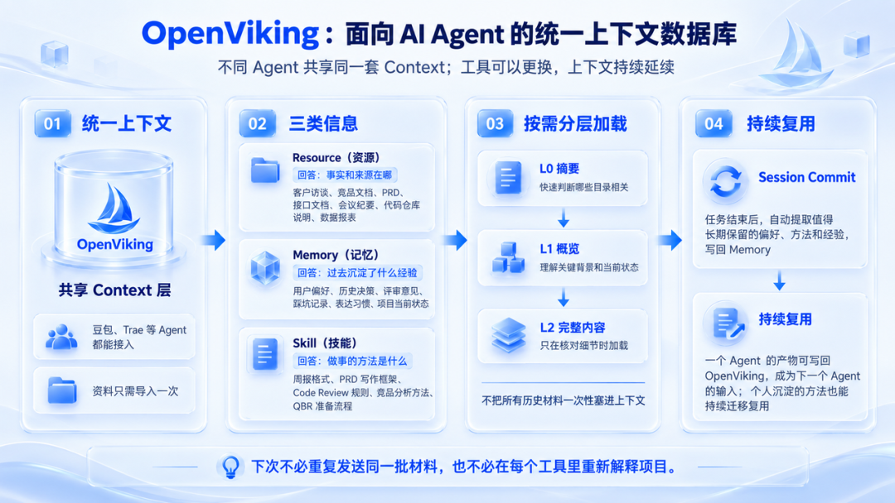
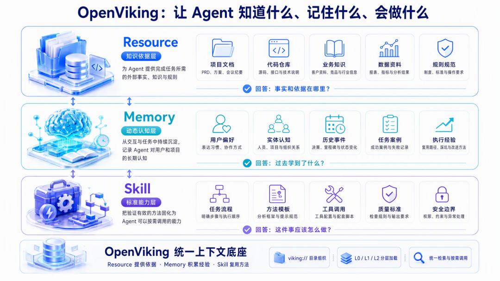
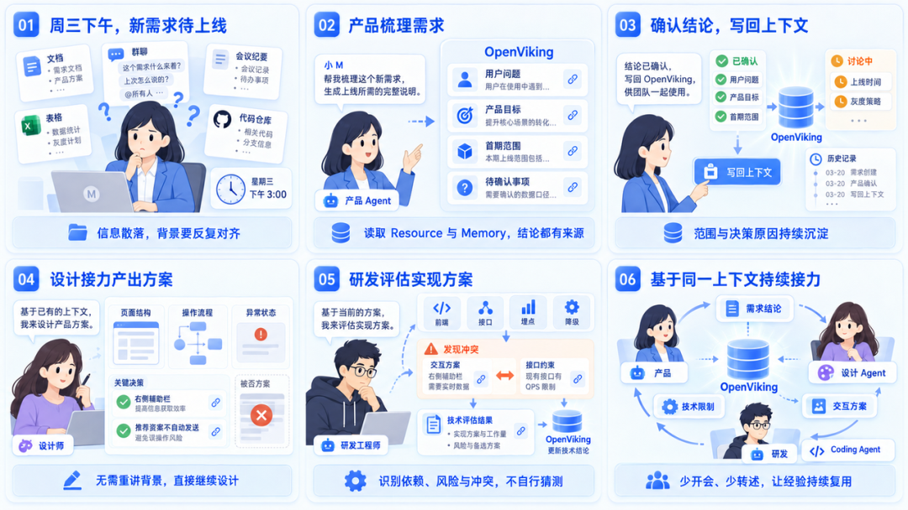
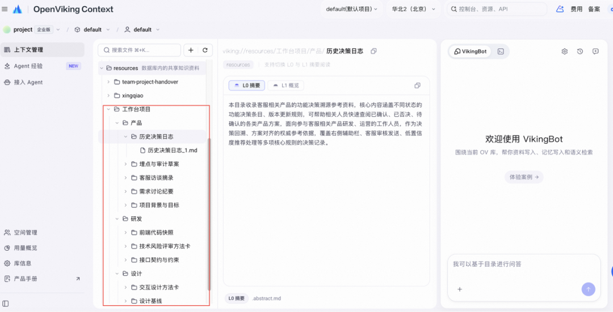
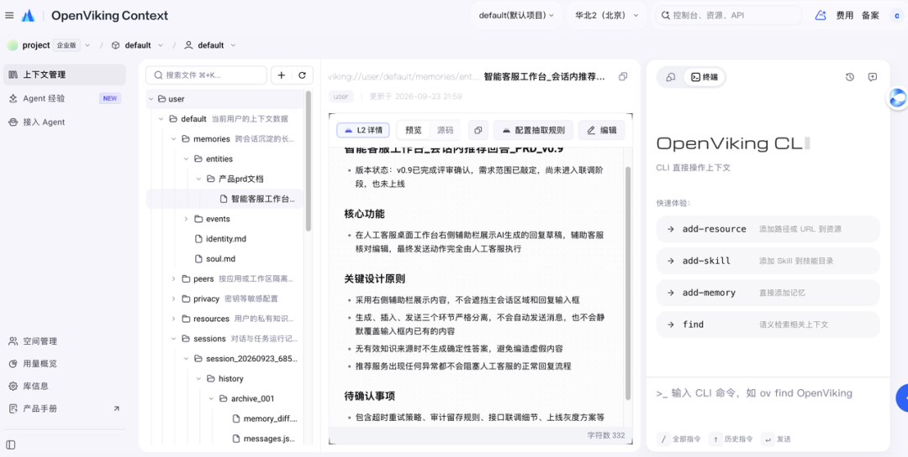
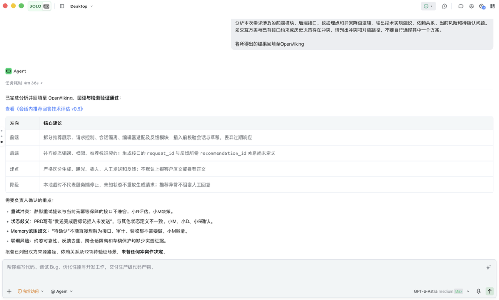

# OpenViking：让不同 Agent 共享同一套办公上下文

> **来源**：微信公众号文章（火山引擎）｜ **原文**：https://mp.weixin.qq.com/s/0m_OlSoV55nNt9URe-AE9w
> **开源仓库**：https://github.com/volcengine/OpenViking
> **蒸馏日期**：2026-09-23

---

# 一、一句话说清

> **OpenViking = 位于不同 Agent 背后的「共享上下文层」（统一上下文数据库）。**
>
> **豆包、Trae、Codex 等都可以接到同一个 OpenViking 上读写 —— 工具换了，上下文不丢。** ✅

**它要解决的问题**：
> ⚠️ **AI 工具越多，经验越分散** ——
> **写方案用一个、查资料用一个、分析数据再换一个，
> 每换一个 Agent 就要重新上传资料、解释背景，协作效率没同步提升。** ⚠️
>
> **原文判断（可引用）**：
> **"AI 办公效率的差距，不在于使用多少个 Agent，更在于它们能否共享信息、复用经验，并延续完整的工作上下文。"** ⭐

---

# 二、⭐ 核心机制：三类信息 + 三层加载 + 自动沉淀

## 2.1 三类信息（**最该记的部分**）

| 类型 | 回答的问题 | 对应我们的 |
|------|-----------|-----------|
| **Resource（资源）** | **事实和来源在哪** | 知识库 / 原始文档 |
| **Memory（记忆）** | **过去沉淀了什么经验** | 历史决策 / 踩坑记录 |
| **Skill（技能）** | **做事的方法是什么** | **我们的 Skill 体系** ✅ |

**⭐ 三类统一组织成「带路径的目录和文件」** —— **每条结论都能回到原文核对** ✅

## 2.2 三层加载（**按需分层**）

| 层 | 内容 | 什么时候读 |
|---|------|-----------|
| **L0** | **摘要** | 先判断**哪些目录相关** |
| **L1** | **概览** | 了解**关键背景和当前状态** |
| **L2** | **完整内容** | **只有核对细节时**才加载 |

> **⭐ 原文**："Agent 不需要把所有历史材料一次性塞进上下文，而是按需分层加载。"
> **→ 这跟 Anthropic 的「渐进式披露」是同一个思路** ✅

## 2.3 ⭐ Session Commit（**自动沉淀**）

> **任务结束后**，从这次对话和执行过程中**提取值得长期保留的偏好、方法和经验**，
> **自动写回 Memory** ✅

**⭐ 这一条最重要**：
> **它让"上下文"从"用完就丢"变成"自动积累"** ——
> **跟百炼的"数据飞轮"、WorkBuddy 的"上下文飞轮"是同一件事** ✅

---

# 三、三个使用场景（原文的案例）

## 场景 1：新人接手（降低交接成本）

**痛点**：几十份文档不知先看哪份、十几个群分不清在做什么、交接会听完一脸懵

**解法**：**新人能读取资料 + 继承前任的经验和 Skill**

**⭐ 原文给的 prompt（可直接抄）**：
```
请读取 OpenViking 中与【项目名】相关的 Resource、Memory 和 Skill。并输出：
1. 用一句话说明这个项目要解决什么问题；
2. 项目当前阶段、目标指标和首期范围；
3. 关键决策时间线，并说明每项决策背后的原因；
4. 当前团队分工，以及遇到不同问题应该找谁；
5. 已完成、进行中、当前风险和待确认事项；
6. 上一位负责人沉淀的经验和踩坑记录；
7. 当前可以直接复用的 Skill，以及每个 Skill 的适用场景；
8. 我第一周建议阅读的文件和建议完成的事项。

每条关键结论后附上真实路径，方便我回到原文核对。
请明确区分"已确认""讨论中""已失效"和"缺少依据"的信息。
不确定的地方直接标注，不要替项目补充结论。
```

**⭐ 这个 prompt 的三个亮点**：
1. **8 个问题**覆盖"项目是什么 / 到哪了 / 找谁 / 有什么经验 / 能复用什么" ✅
2. **每条结论附路径**（可核对）✅
3. ⭐ **要求区分"已确认/讨论中/已失效/缺少依据" + 不确定就标注** ✅
   —— **这正是"不编造"的工程化写法**

## 场景 2：团队协作（产品→设计→研发接力）

**解法**：**把分散资料统一组织**
- 原始文档 → **Resource**
- 历史决策、项目状态、踩坑经验 → **Memory**
- PRD 框架、评审规则、协作流程 → **Skill**

**⭐ 关键**：**同一套上下文，不同角色在各自 Agent 里接力产出**
（产品用豆包 → 设计用 Codex → 研发用 Trae，**共享同一份项目上下文**）

**⭐ 需求梳理 prompt（可直接抄，含"不自行选择"）**：
```
请读取 OpenViking 中"【项目名】"项目的相关 Resource 和 Memory，
重点查看客户访谈、需求讨论、历史决策和当前项目状态。

请先整理一份需求梳理结果，包括：
· 用户是谁，在什么场景下遇到了什么问题
· 本次需求希望达成的产品目标
· 已确认的首期范围，以及明确暂不纳入的内容
· 历史上讨论或否决过的方案，以及对应原因
· 尚未确认的问题、缺失的信息和已有记录中的确认负责人

请将"已确认结论"和"仍在讨论的方案"分开呈现，每项关键结论附上来源路径。
如果不同资料之间存在冲突，请列出冲突及来源，不要自行选择。
资料没有说明的内容标注为"待确认"，不要补充推测。
```

**⭐ 重复出现的三条纪律**（原文所有 prompt 都有）：
| # | 纪律 | 说法 |
|---|------|------|
| **1** | **不自行选择** | "如果存在冲突，请列出冲突及来源，不要自行选择" |
| **2** | **不补充推测** | "资料没有说明的内容标注为『待确认』" |
| **3** | **附来源路径** | "每项关键结论附上来源路径" |

> **⭐⭐ 这三条，跟我们 Skill 里的"异常兜底（缺料就停下、不硬凑）"是同一个原则** ✅

## 场景 3：个人办公（**跟我们最相关**）

### ① 周报（⭐ 跟你的场景几乎一样）

**原文场景**：小 M 在 Codex 设了周日定时任务生成周报，**但额度耗尽没跑成** ——
**因为上下文都存在 OpenViking 里，换个工具（Trae）接上就能继续** ✅

**⭐ 原文的周报 prompt（可直接抄，含大量可用细节）**：
```
创建一个每周日晚上 7 点运行的周报定时任务，创建后立即试跑一次。

优先遵循我已保存的周报格式与写作偏好。生成前，读取我的角色、职责、目标、
重点项目和汇报对象；检索我有权访问的全部相关空间中的本周工作记录与关联产物，
必要时参考近四周背景。不要将检索范围局限于当前对话或工作区，
也不要按记录多少判断项目重要性。

根据我的职责和汇报对象，选择合适的表达层级。没有自定义格式时，按以下结构生成：
· 本周进展：选取最重要的 3—5 项结果，写清实质变化、当前阶段及其意义；证据不足时可以少写。
· 问题与风险：说明关键问题、影响，以及需要推动、协调或决定的事项。
· 下周计划：围绕预期结果展开，衔接本周目标与风险，并写明完成标准。

事实以有证据支持的最新明确状态为准。准确区分研究、草案、待评审和已落地，
不把计划写成成果，不编造缺失信息；过滤普通维护、琐碎过程和过期状态。

输出前，从接收者视角检查成果是否清楚、风险是否明确、计划是否衔接，
以及是否符合我的偏好，修改至通过。只输出可供我审阅、转发的周报，
不展示检索与检查过程，除非我要求附上来源。

若信息不足，首次试跑时向我询问关键缺口；后续定时执行时，简要说明缺少什么，
不用零碎事项凑数。
```

**⭐ 这段 prompt 里值得学的 5 处**：
| # | 写法 | 为什么好 |
|---|------|---------|
| **1** | **"不要按记录多少判断项目重要性"** | 防止"谁写得多谁重要"的误区 ⚠️ |
| **2** | **"不把计划写成成果"** | ⭐ **防止把"打算做"说成"已做完"** |
| **3** | **"准确区分研究、草案、待评审和已落地"** | ⭐ **状态分级，不混为一谈** |
| **4** | **"输出前从接收者视角检查"** | 自检环节 ✅ |
| **5** | **"信息不足时先问，不用零碎事项凑数"** | ⭐ **对应我们的"不硬凑"** |

### ② ⭐⭐ 个人 Skill 沉淀（**这段对我们最有价值**）

**原文场景**：小 M 发现自己每次评审都反复检查同样的事 → **让 Agent 检索历史记录，提炼规则，写成个人 Skill**

**⭐ 原文的 prompt**：
```
检索我有权访问的相关空间中，近三个月由我参与的需求文档、评审记录、
修改意见和项目复盘，提炼我在需求评审中反复使用且已经验证有效的方法，
生成一个可复用的个人需求评审 Skill。

这个 Skill 需要定义：
1. 适用场景和触发条件；
2. 评审前需要读取的业务背景、用户问题、目标和历史决策；
3. 对用户价值、业务目标、方案完整性、数据口径、异常场景和上下游影响的判断方法；
4. 如何区分阻塞问题、重要建议和一般优化；
5. 如何识别证据不足、目标不可验证、方案与问题错位等风险；
6. 输出评审结论、修改建议和待确认事项的格式；
7. 信息不足时应该追问哪些关键问题；
8. 输出前的质量检查标准。

只沉淀跨项目仍然有效的方法，不写入某个项目的具体状态、临时结论、
人员评价或敏感信息。生成后保存为一个可供 OpenViking 导入的 Skill。
```

**⭐⭐ 为什么这段最有价值**：
> **它给出了"从历史记录自动提炼 Skill"的完整方法论**：
> **① 检索范围**（近三个月、我参与的）→ **② 提炼标准**（反复使用 + 已验证有效）
> → **③ Skill 八要素**（触发条件/前置输入/判断方法/分级/风险识别/输出格式/追问/质检）
> → **④ 过滤纪律**（只沉淀跨项目有效的，**不写具体状态、临时结论、人员评价、敏感信息**）✅
>
> **⚠️ 注意最后那条过滤纪律** —— **这对你有直接价值**（避免把公司敏感信息写进 Skill）✅

---

# 四、⭐⭐ 跟我们项目的对照（**我的判断**）

## 4.1 逐项对照

| OpenViking | 我们的（AI 原生研发体系 / Skill 手册） | 判断 |
|-----------|-----------------------------------|------|
| **Resource / Memory / Skill 三类** | 知识库设计 + Skill 体系 | ⭐ **可直接对齐**（我们是分散的，它统一了）|
| **L0 / L1 / L2 三层加载** | **Anthropic 渐进式披露** | ⭐ **同一个思路**（三级加载 ~100 token / 5k / 零成本）|
| **Session Commit 自动沉淀** | 百炼"数据飞轮"、WorkBuddy"上下文飞轮" | ⭐ **三个厂商都指同一件事** |
| **资源隔离（企业版）** | 我们的"安全"块（权限/审计） | ✅ 一致 |
| **个人 Skill 沉淀** | 我们的 Skill 手册 | ⭐ **就是你在做的事** |

## 4.2 ⭐⭐ 一个关键判断

> **火山引擎、阿里云、腾讯三家的材料，讲的是同一件事** ⚠️
>
> | 厂商 | 说法 |
> |------|------|
> | **阿里云百炼** | 三类记忆（**事实 / 用户画像 / 技能**）+ 数据飞轮 |
> | **腾讯 WorkBuddy** | **上下文飞轮**（每次协作，组织能力资产增厚一层）|
> | **火山 OpenViking** | **Resource / Memory / Skill** + Session Commit |
>
> **⭐ 三家的共同点**：
> **都在解决"让 AI 的产出留得下、查得到、传得下去"** ✅
> **这说明它不是某家的特色，而是**行业共识** —— 也就是"真需求"** ✅

## 4.3 ⭐ OpenViking 的**独特之处**（跟我们最相关）

> **它是"独立的一层"，不属于任何一个 Agent** ✅
>
> **→ 这是"Agent 无关"的解法**：
> **工具可以换（豆包/Codex/Trae），但上下文层一直在** ✅
>
> **⭐ 对我们的启示**：
> **工作台不该做成"又一个 Agent"，而该做成"跨工具共享的上下文层"** ⚠️

## 4.4 ⚠️ 但要冷静看

| 项 | 提醒 |
|---|------|
| **厂商自述** | 火山引擎自家产品，**能力描述为自述** —— 引用需注明 |
| **开源可核查** | ⭐ **github.com/volcengine/OpenViking** —— 这点比纯 PPT 材料强 ✅ |
| **效果数据** | 文章**没有给具体提效数字**（只有场景描述）⚠️ |
| **依赖** | 需接入其服务（`ov add-skill` / MCP）→ **数据放在谁那里，是选型时要问的** ⚠️ |

---

# 五、⭐ 可复用的东西（4 个 prompt 模板）

| # | 模板 | 用在哪 |
|---|------|-------|
| **1** | **新人接手 8 问** | 交接/接手项目 |
| **2** | **需求梳理**（区分已确认/讨论中，冲突列出）| **需求分析** ⭐ |
| **3** | **周报生成**（含"不把计划写成成果"）| **你的周报 skill** ⭐ |
| **4** | **个人 Skill 沉淀**（八要素 + 过滤纪律）| **你的 Skill 手册** ⭐⭐ |

**⭐ 三个通用纪律（所有模板都有，可直接搬进我们的 Skill）**：
```
① 不自行选择 —— 冲突时列出冲突及来源，不要替我做决定
② 不补充推测 —— 资料没说的标注「待确认」
③ 附来源路径 —— 每条关键结论都能回到原文核对
```

---

# 六、可引用句

> · **"AI 办公效率的差距，不在于使用多少个 Agent，更在于它们能否共享信息、复用经验，并延续完整的工作上下文。"**
> · **"工具可以换，协作可以接力，团队的经验应该留下来。"**
> · **"人与 Agent 的协作，不必再每次从头开始，而是在过去的积累上不断向前推进。"**
> · **"资料只需导入一次。"**

---

# 七、原文信息

| 项 | 内容 |
|---|------|
| **标题** | OpenViking：让不同 Agent 共享同一套办公上下文 |
| **出品** | 火山引擎（Volcengine）|
| **产品** | OpenViking —— 面向 AI Agent 的统一上下文数据库 |
| **开源** | https://github.com/volcengine/OpenViking |
| **文档** | docs.volcengine.com/docs/vector_database_vikingdb/Compile-Compileresources |
| **原文链接** | https://mp.weixin.qq.com/s/0m_OlSoV55nNt9URe-AE9w |
| **正文字数** | 约 11,400 字 ｜ 21 张图 |
| **关键概念** | Resource / Memory / Skill ｜ L0-L1-L2 ｜ Session Commit |

---

# 八、一句话总结

> **OpenViking 把"上下文"做成了可管理的资产**：
> **三类信息（Resource/Memory/Skill）+ 三层加载（L0/L1/L2）+ 自动沉淀（Session Commit）** ✅
>
> **⭐⭐ 它的价值不在"新功能"，而在它把三件事做成了产品**：
> **① 经验留得下（Memory）　② 方法传得下去（Skill）　③ 换工具不丢（独立一层）**
>
> **⭐ 而这恰好是"AI 原生研发体系"的核心命题** ——
> **怎么让 AI 的产出"留得下、查得到、传得下去"** ✅
> **⚠️ 补充：阿里云、腾讯、火山三家材料讲的是同一件事，说明这是行业共识（真需求）** ✅

---
*蒸馏：Hermes ｜ 2026-09-23 ｜ ⚠️ 厂商材料，能力描述为自述；产品已开源，可核查*

---

# 九、原文配图（6 张）

> 从原文章抓取（对应原文的架构图与流程图）
> ⚠️ 图片内容以原文为准，此处仅作索引


*▲ 配图 1（原文第 1 张）*


*▲ 配图 2（原文第 2 张）*


*▲ 配图 3（原文第 3 张）*


*▲ 配图 4（原文第 4 张）*


*▲ 配图 5（原文第 5 张）*


*▲ 配图 6（原文第 6 张）*
